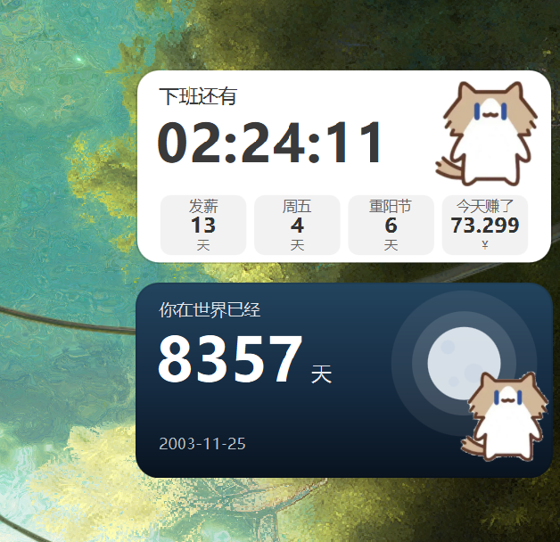

# 桌面组件（DesktopWidget）

Windows 桌面小组件：**贴在壁纸层上**（桌面图标之下、被普通窗口正常遮挡）的透明圆角卡片 —— 下班倒计时 + 纪念日，参考手机端同名组件的形态复刻。Qt 6.8 + QML，绿色免安装。



## 功能

- **下班倒计时卡**：按你设置的工作时段实时走秒（非工作日显示"今天休息"），下排四个小格 = 距离发薪日 / 距离周五 / 下一个节日（**含农历节日与节气**）/ 今天赚了（按秒累积，3 位小数）
- **纪念日卡**：小字事件名 + 大号天数 + 起始日期，背景可选纯色 / 内置月夜渐变 / 自定义图片；三种模式：
  - `倒计时`：还有多少天（不重复 / 每年 / 每月）
  - `纪念日`：已经多少天
  - `农历节日`：春节 / 元宵 / 龙抬头 / 端午 / 七夕 / 中元 / 中秋 / 重阳 / 腊八 / 小年 / **除夕**，或自定义农历月·日（农历生日）
- **多张卡片**：一张卡一个独立窗口，各自摆位、各自配色；设置面板里「＋倒计时 / ＋纪念日 / 删除」
- **贴壁纸层**：不是置顶窗，不抢焦点、不进 Alt-Tab；普通窗口正常盖住它
- **编辑模式**：托盘 → 编辑模式 → 拖动摆放 → 完成（位置自动保存，越界自动拉回屏内）
- **设置面板**：左侧实时预览 + 右侧深色配置行，**改动即时生效、没有保存按钮**；含自绘深色日历选日期
- **卡通形象**：默认用你自己的猫图（设置里可切"矢量自绘"或隐藏）
- **托盘常驻** + **开机自启**（写 HKCU，无需管理员；绿色包换目录后自动纠正路径）

## 下载即用（绿色免安装）

到 [Releases](../../releases) 下载 `DesktopWidget-v*-win64-portable.zip`，**解压后双击 `DesktopWidget.exe`** 即可 —— 包内自带 Qt 6.8.3 运行库与 VC143 CRT，不需要装 Qt、也不需要装 VC++ 运行库。用法详见包内 `README-zh.txt`。

- 首次运行会在桌面右下角出现两张卡片，托盘（右下角小图标）里有全部操作
- 配置写在 `%APPDATA%\wei\DesktopWidget\config.json`，删掉它即恢复默认

## 环境要求

Windows 10 / 11 x64。**不支持** Windows 7。

## 从源码构建

需要 Qt 6.8 的 `msvc2022_64` 套件 + Visual Studio 2022（或 BuildTools，需含 cmake/ninja）：

```bash
git clone https://github.com/1125wei/desktop-widget.git
cd desktop-widget
MSYS_NO_PATHCONV=1 cmd /c "tools\build.bat"     # 工具链不在默认位置时：set QT_DIR / VS_DIR
MSYS_NO_PATHCONV=1 cmd /c "tools\package.bat"   # 生成绿色 zip → dist/
bash tools/verify_ui.sh                          # 回归（12 节，需要真实 Windows 桌面）
```

> `tools/*.bat` 请保持**纯 ASCII**：cmd 按 GBK 读取，中文会让引号/续行解析错乱。

## 版本与协作

- 当前版本 **V0.3.0**，变更记录见 [CHANGELOG.md](CHANGELOG.md)，逐版说明见 `VERSION_V<版本号>.md`（五段式：版本信息 / 更新与修改 / 解决的问题 / 实现效果 / 待解决问题）
- 分支约定：`feat/*`、`fix/*`、`docs/*` → PR → `main`；提交信息格式 `V<版本号>: 一句话摘要`
- 发版前必跑清单见 [CHANGELOG.md](CHANGELOG.md) 末尾（"改了什么跑什么"）

## 许可

代码以 [MIT](LICENSE) 许可发布。

⚠️ 例外：`assets/mascot.png`（卡通猫形象）是使用者提供的第三方美术素材，**不在 MIT 许可范围内**，再分发前请自行确认授权；不使用它的话在设置里把"卡通形象"设为隐藏、或换成自己的图片即可。

## 开发与验证记录（逐轮）

### ✅ 已完成并实测验证（第一轮：打通最难的那一层）

| 项 | 证据 |
|---|---|
| Qt 6.8.3 + QML 工程骨架，**构建链零下载**（MSVC 在 `D:\dev\VS2022BuildTools`，Qt 在 `D:\Qt`） | `tools/build.bat` 构建通过 |
| 无边框 / 透明 / `Qt::Tool` 窗口，不进任务栏与 Alt-Tab | `EnumWindows` 查无顶层窗口 ✓ |
| **桌面层挂载**：Auto 选层（老 Win10→WorkerW，本机 Win11 25H2→Progman）+ 3s 看门狗重挂 | `parent=Progman 0x1013c` ✓ |
| 卡片视觉复刻：标题 + 大号描边倒计时 + 四宫格 + 形象素材占位框 | `docs/card-render.png` |
| 真实数据：倒计时按工作日 08:30–17:30 实时走秒；四宫格=日期差 + 按秒累积收入 | 实测与手算一致 |
| 无打扰自检：`DW_PROBE` 抓屏幕区域 + `PrintWindow` 抓壁纸层内容 | `docs/card-on-desktop.png`（卡片叠在壁纸上）✓ |

### ✅ 已完成并实测验证（第二轮：交互入口 + 持久化）

| 项 | 证据 |
|---|---|
| **托盘常驻**（QSystemTrayIcon）：显示/隐藏组件、编辑模式开关、重新挂载、退出 | 日志 `托盘已就绪 isSystemTrayAvailable=true` ✓ |
| **编辑模式**：进入时脱离桌面层变可点击置顶窗口（虚线框 + 「拖动摆放位置/完成」胶囊），退出后自动挂回桌面层并存盘位置 | 日志 `edit: parent=<top-level>` → `back: parent=Progman` ✓；`docs/edit-mode.png` |
| 拖动摆放（Win32 物理像素，兼容 150% 缩放） | `dragMove` 走 `GetWindowRect/SetWindowPos` |
| **配置持久化** `%APPDATA%\wei\DesktopWidget\config.json`（位置、可见性、层模式、工作日、上下班时间、发薪日、日收入、四宫格开关、标题） | 重启读到 `还原位置: 1795 60` ✓ |
| **位置安全**：拖动中 / 存盘前 / 启动还原时三重钳制到显示器工作区；完全在屏外自动拉回右上角；托盘「重置位置」一键找回 | 实测 5000,3000 → 1795,60；1861,824 → 1847,824（越界 6px 被纠正）✓ |
| **退出二次确认** + 托盘每个动作写日志（防止误点退出后"组件凭空消失"且无法诊断） | 日志 `[tray] 用户确认退出` |
| 回归脚本 `tools/verify_ui.sh`（编辑模式端到端 + 位置持久化 + 5 种层策略） | 全绿 ✓ |
| 卡片尺寸按参考截图 1:1（470×206 逻辑像素） | 150% 缩放下物理 705×309 ✓ |

### ✅ 已完成并实测验证（第四轮：尺寸可调 + 清晰度修复）

| 项 | 证据 |
|---|---|
| **组件大小可调**：设置里新增「组件大小」滑块（240–760 逻辑像素），实时改、实时生效 | 默认 **312** = 与你桌面上那个「收集箱」面板同宽（实测其宽 469 物理像素 ≈ 312×1.5） |
| **清晰度修复（三层原因）**：① 去掉倒计时 `Text.Outline` 灰色描边（小尺寸下就是"糊边"）② 提高对比度（默认字色 #5A5A5A → #3A3A3A，小卡标签/数值加深）③ 软阴影换成极浅描边（边缘不再发虚） | `docs/sharpness-compare.png` 前后放大对照 |
| **切到 `Text.NativeRendering`（最大杠杆）**，走 Windows 原生字形光栅化 | 同尺寸、同数字的 A/B（Laplacian 方差）：470 宽 **1292 → 2775（+115%）**；312 宽 1893 → 3192（+69%） |
| 验证渲染分辨率本身没问题（曾怀疑 DPR 掉到 1.0） | 日志 `view DPR = 1.5 / 屏幕 DPR = 1.5`；屏上实拍 1180 vs 离屏渲染 1256（只差 6%） |
| 排除无效方案：`font.hintingPreference: PreferFullHinting` | 实测 1270 vs 1292（**-1.7%，已弃用**） |
| **修掉两个真 bug**：① `setConfig()` 未发 `styleChanged` 且在主窗口 QML 加载**之后**才调用 → 配置里的值（尺寸/颜色/字体）根本传不进 QML（颜色默认值恰好相同所以一直没暴露）② cmd `set VAR=value &&` 吞空格 → 环境变量带尾空格，QML 加载失败 | 修复后 `view逻辑尺寸 = 470x206`（此前一直是 312 默认值） |
| 新增测试钩子 `DW_FREEZE`（钉死"当前时间"），让渲染完全可复现 | 清晰度 A/B 的指标从此无漂移 |
| 新增开发/诊断工具：`run_dev.bat`、`run_qml.sh`（改 QML 免重编译）、`setcfg.py`、`measure_focus.py`、`diag_sharpness2.py`、`make_compare.py` | 都在 `tools/` |

### ✅ 已完成并实测验证（第六轮：多卡片 + 纪念日卡 + 节日表 + 打包）

| 项 | 证据 |
|---|---|
| **多卡片架构**：一张卡 = 一个 `CardBackend` + 一个 `QQuickView`（各自挂桌面层、各自摆位）。不动已跑通的 Win32 挂载逻辑，只为"每张卡独立"付一次复用成本 | 日志 `[card] 0 下班倒计时 窗口已建` / `[card] 1 纪念日 窗口已建`；两张卡同屏见 `docs/multi-card-desktop.png` |
| **配置 v2**：`cards[]` 数组，每卡独立类型/位置/尺寸/配色/参数；**v1 扁平配置自动迁移**（位置与设置不丢） | 日志 `[migrate] 检测到 v1 扁平配置 → 迁移为 cards[0] 倒计时卡 位置 2084 829 宽度 312` |
| 修掉多窗口隐患：桌面层的"原始窗口样式"缓存从**全局单份**改成**按窗口 QHash** | 修前第 2 张卡退出编辑会还原成第 1 张卡的样式 |
| **纪念日卡**：事件名 + 大号天数 + 起始日期；重复规则 不重复/每年/每月；背景 纯色/内置月夜/自定义图片 | `docs/anniversary-moon.png`、`docs/anniversary-image.png` |
| 纪念日口径实测：2026-10-12 → 每年 5-20 = **220 天**（手算一致） | 同一日志 |
| **节日表离线生成**（`tools/gen_festivals.py` + cnlunar）：2025–2045 共 **482 条**，含农历节日（除夕/元宵/端午/七夕/中元/中秋/重阳/腊八）与节气（清明/冬至） | `assets/festivals.json`；2026-10-12 的下一个节日 = **重阳节 10-18（6 天）**，与参考截图逐字一致 |
| **官方放假 + 调休补班**（NateScarlet/holiday-cn）：2025/2026 为官方年份（含 11 天补班），其余年份按法定假日 + 用户自配工作日 | 日志 `官方年份 QList(2025, 2026)`、`调休补班 11 天` |
| 图片背景**圆角**：Canvas `destination-out` 反向擦角 | 四角像素 alpha=0 实测（MultiEffect 遮罩亦可，实测两者只差 0.3%，仅抗锯齿边不同） |
| 设置界面升级：卡片圆点选择器 / ＋倒计时 ＋纪念日 / 删除（带确认）/ 按类型显示配置行 / 背景三态切换 | `docs/settings-cards.png`、`docs/settings-anniv.png` |
| **开机自启**（HKCU Run，无需管理员）+ 写后读回校验 | 日志 `[test] 开机自启 开启: true 注册表值 = "D:\desktop-widget\build\DesktopWidget.exe"`，恢复后清空 |
| **绿色免安装打包**：windeployqt 带 Qt 运行库 + 平台插件 + QML 模块，并自包含 VC143 CRT | `tools/package.bat` → `dist/DesktopWidget-0.3.0.zip` |

### ✅ 已完成并实测验证（第七轮：修日期输入 + 纪念日两种模式）

| 项 | 证据 |
|---|---|
| **修掉"设置日期没反应"**（用户报告）。根因两条：① 输入框用了 `inputMask:"9999-99-99"`，掩码**放行 `2027-3-5` 这种不带前导零的写法**、又**认为 `2027-02-31` 完全合法**（`acceptableInput=true`）② 解析失败时 C++ 只发信号，而 QML 的"回退显示"被 `!dateField.activeFocus` 挡住 —— 用户还在输入框里，焦点没走 → **框里留着他打的字、模型还是旧值、卡片毫无反应** | 无头实验日志：`赋 2027-3-5 后: text=[2027-3-5] len=8 acceptable=false`、`赋 2027-02-31 后: acceptable=true`、`赋 2027-03 后: text=[2027-03-]` |
| 修法：**去掉 inputMask**（`inputMethodHints: Qt.ImhDigitsOnly`），改宽松解析（`2027-3-5` / `2027/03/05` / `2027.3.5` / `2027年3月5日` / `20270305` 全接受）→ 归一化成 `yyyy-MM-dd`；提交走 `Q_INVOKABLE bool applyDateInput()`，**失败返回 false**，QML 立刻把框恢复成已存值 + 顶部红条提示 | `[test-anniv] 输入 2027-3-5 → 接受，配置日期 2003-11-25 → 2027-03-05`；`输入 2027-02-31 → 拒绝，2003-11-25 → 2003-11-25`；8 种输入 5 接受 3 拒绝全对 |
| 新增**日历选择器**（自绘深色，6×7 格子 + 年月导航 + 今天/取消），不想打字直接点 | `docs/settings-anniv-datepicker.png` |
| **纪念日两种模式**：`倒计时（还有多少天）` / `纪念日（已经多少天）`，存进 `cards[].annivMode` | `docs/anniversary-countdown-mode.png`（距离生日还有 144 天 / 2027-03-05）、`docs/anniversary-anniv-mode.png`（你在世界已经 8357 天 / 2003-11-25） |
| 口径抽成**唯一实现** `AnnivMath::compute()`，卡片与设置界面预览共用（不会两处算法漂移） | 自检 6/6：`countdown/2027-03-15/none → 154` ✓、`anniversary/2003-11-25/none → 8357` ✓、`countdown/2000-10-20/monthly → 8` ✓ … |
| 设置界面加**「卡片会显示：xxx」实时预览** + **红字提醒**（倒计时遇过去的日期 / 起始日在未来 / 年份疑似打错） | `[test-mode] 倒计时/不重复/过去的日期 → 卡片会显示[距离生日还有 0 天] 提醒[该日期已经过去，倒计时只会停在 0 天…]` |
| 切换模式时自动纠正"措辞不匹配"的默认事件名（你在世界已经 ⇄ 距离生日还有），「常用事件」按模式给不同措辞 | 日志 `纪念日模式: countdown → anniversary 事件名: 你在世界已经` |
| 倒计时模式下卡片底部日期显示**下一次的那天**（每年/每月时比显示原始日期更有用） | 上面两张样张对比 |
| 顺手同类修掉工作时间的同款隐患（`inputMask:"99:99"` → 宽松解析 + 失败明确回退） | `applyTimeInput("start"/"end", …)` |

### ✅ 已完成并实测验证（第八轮：卡通形象 + 农历节日模式）

| 项 | 证据 |
|---|---|
| **卡通形象 = 用户提供的猫**（默认）：源图白底，用**从四边向内泛洪**把外部白抠成透明（猫肚子也是白的，靠深棕描边围住所以泛洪进不去 → 身体保留）。处理脚本 `tools/prepare_mascot.py` → `assets/mascot.png` | `docs/mascot-user-check.png`（灰底合成检查无白边、肚子完整） |
| 素材已换用**高清版**（用户后来给的 1397×1280 图 → 抠完 800×822）：那张其实是 **JPG + 画上去的棋盘格**（JPEG 没有 alpha 通道），按"假透明"处理。踩坑：阈值卡太高（238）→ 压缩噪点形成"墙壁"，泛洪过不去留下斑点、裁框被撑到整张画布；**降阈值到 228 + 只保留最大连通块**后裁出 800×822 且干净 | `docs/mascot-compare-src.png`（左=旧 474 版，右=新 800 版，边缘都干净） |
| 形象位置：窄版在倒计时数字右侧空档｜宽版在右侧形象位｜纪念日卡在月亮前面 | `docs/card-mascot-narrow.png`、`docs/card-mascot-anniv.png` |
| 设置里三选一：**图片（你的猫）/ 矢量自绘 / 隐藏**（`mascotMode` + `showMascot`） | 设置 → 卡通形象 |
| 自绘矢量猫保留为备选（`Mascot.qml` 里的 Canvas 分支）：`tools/mascot_preview.py` 能用同一套路径数据离线出预览图，改形不用重编译 | 切到"矢量自绘"实测能正常渲染（注意切回时尺寸没变，需 `onVisibleChanged` 里 `requestPaint()`） |
| **教训**：一开始想"避版权"自己重画，结果画出来跟用户的猫差太远（用户直接质问"我传的猫怎么成这样了"）。**用户自己提供的素材就用他自己的**，自绘只作为没有素材时的兜底 | — |
| **农历节日模式**（新增第 3 种模式）：春节/元宵/龙抬头/端午/七夕/中元/中秋/重阳/腊八/小年/**除夕**，或自定义农历月/日（农历生日） | 模式行三个选项「倒计时 / 纪念日 / 农历节日」 |
| 农历数据**离线生成**：`lunarMonths` 表（每个农历年每个月初一 → 公历，含闰月）+ `lunarEvents` 清单，写进 `assets/festivals.json` | 日志 `[festivals] … 农历月初 N 条/农历节日 11 个` |
| 口径：节日一律取**非闰月**；腊月三十遇该月只有 29 天 → 退到月末；除夕 = 春节前一天（随年份 29/30 变） | 自检 9/9：春节→2027-02-06、除夕→2027-02-05、中秋→2027-09-15、重阳→2026-10-18、端午→2027-06-09；农历九月初九→2026-10-18、腊月廿三→2027-01-30、腊月三十→2027-02-05（月末）、正月初一→2027-02-06 |
| 切到农历模式会自动把措辞改成「距离X还有」，常用事件也给农历专用措辞 | 日志 `[settings] 农历节日 → chunjie 事件名: 距离春节还有` |

### ⬜ 待办（下一轮）

- ⬜ 卡片吸附对齐（拖动时贴边/互相对齐）
- ⬜ 多显示器：目前按卡片所在显示器钳制，跨屏摆放未实测
- ⬜ 形象素材可选多套（现在只有一只猫；想换风格改 `Mascot.qml` + `tools/mascot_preview.py`）
- ⬜ 农历表目前 2025–2045（超出范围卡片显示 “-” 并给提示）


### ✅ 已完成并实测验证（第五轮：修「拖动后消失」+ 窄尺寸字号）

| 项 | 证据 |
|---|---|
| **修掉"拖动后点完成 → 组件消失"（真因是 z 序）**：之前用 `HWND_BOTTOM` 把卡片沉到 Progman 子窗口 z 序最底，而 Progman 下**还有一个承载壁纸的 WorkerW 子窗口** → 卡片被压在壁纸下面。改为以 `SHELLDLL_DefView`（图标层）为 z 序锚点插入 | 退出编辑后抓壁纸层渲染内容：`docs/after-edit-check.png` 里卡片在（修复前抓图里完全没有卡片）；`z序锚点: 0x200d8 (SHELLDLL_DefView)` |
| 同时修掉 Qt 在二次挂载后**不重绘**（`isExposed=false`）：hide/show + `RedrawWindow`/`UpdateWindow` 强制曝光 | 日志 `[edit] isExposed = true` |
| 清掉编辑模式残留的 `WS_EX_TOPMOST`（否则 z 序参数被系统忽略） | `describe()` 新增 `selfVisible/topmost` 位，退出后 `topmost=否` |
| **窄尺寸分档布局**（不是等比缩小）：<420 用专用窄版 320x150（去掉空形象位、小字相对放大 11/16/10），≥420 用宽版 470x206 | `docs/card-narrow-312.png`：四宫格文字清晰可读 |
| 设置界面预览改为"按真实宽度渲染 + 整体缩放"，避免预览布局档位与实际不一致 | `SettingsWindow.qml` previewHolder |
| 新增诊断工具：`DesktopLayer::dumpChildZOrder()`（打印父窗口子窗口 z 序） | 日志 `z序[退出编辑后]自顶向下: ...` |
| 回归脚本新增第 6 节：编辑模式退出后必须仍可见 | `tools/verify_ui.sh` |

> 更正：上一轮我把"拖动后组件消失"归因为"误点托盘退出"，**那是误判**。真因是 z 序（`HWND_BOTTOM` 把卡片压到壁纸层之下）。教训：用户报的 bug 自己先复现再归因。


### ✅ 已完成并实测验证（第三轮：设置界面）

| 项 | 证据 |
|---|---|
| **深色长面板设置窗口**（复刻手机版）：左侧实时预览 + 右侧一列配置行，自绘标题栏/关闭按钮 | `docs/settings-window.png` |
| 配置项：组件名称、工作日（周一到周日 + 「工作日」预设）、工作时间、背景色板（16 色 + 自定义）、信息格底色、字体颜色、字体（系统字体枚举）、显示更多（4 个开关）、发薪日、每天收入（步进器） | 同上，全部可交互 |
| **改动即时生效**：不点保存、不重启，桌面组件同步变化 | 日志 5 次 `[config] 已实时应用`；`docs/live-apply.png`（标题/底色/字色/关掉周五/日收入 200 全部生效，"今天赚了 54.630" 与手算一致） |
| **实时预览 = 同一份组件代码**（`qml/CountdownCard.qml`），非另写的简化版 | 预览区与桌面组件同步变化 |
| 自定义颜色：HSV 三滑块取色器（彩虹圆点触发） | 代码 + 预览实时变化 |
| 托盘「设置…」启用 + 新增「打开配置文件目录」 | 日志 `[tray] 打开设置界面` |
| 自检开关 `DW_SHOT_SETTINGS`（抓设置窗口渲染）/ `DW_TEST_APPLY`（改配置→抓组件→复原） | 已加入 `tools/verify_ui.sh` 第 6 节 |

## 构建 / 运行 / 验证

```bash
# 构建（必须在 git-bash 里这样调，否则 cmd 参数被 MSYS 吃掉）
cd /d/desktop-widget && MSYS_NO_PATHCONV=1 cmd /c "tools\\build.bat"

# 运行（PATH 需含 Qt bin；常驻）
PATH="/d/Qt/6.8.3/msvc2022_64/bin:$PATH" ./build/DesktopWidget.exe

# 开发模式：直接读源码 QML，改 UI 不用重编译
DW_QML_DIR="D:/desktop-widget/qml" ./build/DesktopWidget.exe

# 抓每张卡片自身的渲染结果（离屏核对视觉）
DW_SHOT=1 DW_SHOT_MS=2500 DW_QUIT_MS=3500 ./build/DesktopWidget.exe
#   → %APPDATA%\wei\DesktopWidget\{self-shot-0.png, self-shot-1.png, widget.log}

# 改口径/数据后重新生成节日表（需要 cnlunar：pip install cnlunar）
python tools/gen_festivals.py

# 打包绿色 zip（先构建）
MSYS_NO_PATHCONV=1 cmd /c "tools\\package.bat"
```

**环境变量**

| 变量 | 作用 |
|---|---|
| `DW_LAYER` | `auto`(默认) / `workerw` / `progman` / `bottom` / `float` |
| `DW_PROBE=1` | 抓屏幕区域 + 壁纸层内容 PNG（每张卡各一份 `probe-<i>.png` / `layer-content-<i>.png`） |
| `DW_SHOT=1` | 抓每张卡片自身渲染结果（`self-shot-<i>.png`） |
| `DW_SHOT_MS=2500` | 上面几个抓图的延时（毫秒） |
| `DW_QUIT_MS=5000` | N 毫秒后自动退出（测试用，避免幽灵进程） |
| `DW_QML_DIR=…\qml` | 从源码目录读 QML（热改，免编译） |
| `DW_FREEZE=2026-10-12T11:00:00` | 钉死"当前时间"→ 渲染完全可复现（清晰度 A/B 必需） |
| `DW_SHOT_SETTINGS=1` | 打开设置窗口并抓其渲染结果（`settings.png`） |
| `DW_SETTINGS_CARD=1` | 先选中第 N 张卡片（核对纪念日等类型的配置行） |
| `DW_TEST_APPLY=1` | 改 5 项配置 → 抓卡片渲染 → 复原（验证"即时生效"） |
| `DW_ADD_ANNIV=1` | 新增一张纪念日卡 → 抓渲染（验证多卡片全流程） |
| `DW_SET_ANNIV=1` | 把纪念日卡改成"每年 5-20"→ 抓渲染 |
| `DW_EDIT_TEST=1` | 2s 进编辑模式、5s 退出 → 抓壁纸层内容（验证"退出后还看得见"） |
| `DW_AUTOSTART=1` | 写开机自启注册表 → 读回校验 → 恢复原状 |
| `DW_DRAGLOG=1` | 打印拖动坐标 |

## 核心机制备忘（详细版见技能 windows-desktop-widget）

1. **桌面层挂载**：`SetParent` 前必须 `(style & ~WS_POPUP) | WS_CHILD`，否则静默失败（`GetParent()` 拿到 owner，看着像挂上其实没挂）。
2. **z 序**：挂完用 `MapWindowPoints` 重定位，然后 `SetWindowPos(hwnd, SHELLDLL_DefView 的 HWND, ...)` —— 插到**图标层正下方、壁纸层之上**。
   ⚠️ 绝不能用 `HWND_BOTTOM`：Progman 下还有个承载壁纸的 `WorkerW` 子窗口，沉到底部 = 卡片被壁纸盖住（"挂上了但看不见"）。
3. **多张卡片 = 多个窗口**：桌面层的"原始窗口样式"缓存必须**按窗口**存（`QHash<HWND, ...>`），否则第 2 张卡退出编辑会还原成第 1 张卡的样式。
4. **Win11 25H2**：图标层 `SHELLDLL_DefView` 直接在 `Progman` 下；`0x052C` 造出的 `WorkerW` 是 202x56 的**隐藏**窗口（挂上去=隐身）。有效壁纸层判据：`IsWindowVisible && 宽度>400`。
5. **点不到是正常的**：卡片在图标层之下，鼠标点击被 `SHELLDLL_DefView` 吃掉 → 必须有「编辑模式」。
6. **物理像素 vs 逻辑像素**：Qt 几何是逻辑像素（本机 150%），Win32 是物理像素；摆放/拖动一律走 `GetWindowRect`/`SetWindowPos`。
7. **图片圆角**：`Rectangle{radius}` 不裁子项；Canvas 的 `ctx.clip()` 对图片无效（Qt 的 `drawImage` 绕过裁剪路径）→ 用 `destination-out` 反向擦角。
8. **MSVC 必须 `/utf-8`**，否则中文字面量乱码。


## 已定口径（与参考 App 逐位对齐，均有验证）

| 项 | 口径 | 验证 |
|---|---|---|
| 纪念日天数（不重复） | `起始日期.daysTo(今天)` 取绝对值，不含起始日（过去=已经、未来=还有，都显示正数） | 2003-11-25→2026-10-12 = **8357 天** ✓ 与截图一致 |
| 纪念日（每年） | 下一个周年（今天就是纪念日时为 0）；2/29 遇平年退到 2/28 | 2026-10-12 → 5-20 = **220 天** ✓ 手算一致 |
| 纪念日（每月） | 本月同日（已过则下月），日期不存在时取当月最后一天 | — |
| 今天赚了 | `日收入 × 已过工作秒数 ÷ 工作总秒数`，3 位小数（元角分厘） | 9h=32400s，已过 5866s → 18.10 ≈ 截图 18.099 ✓ |
| 发薪日 / 周五 | 目标日 − 今天（天），当天为 0 | 周一 10-12：周五 4 天、25 日发薪 13 天 ✓ |
| 下一个节日 | 取**严格晚于今天**的最近一条；同日多条时优先 法定 > 传统 > 常见节日。含**不放假**的传统节日（重阳） | 482 条表实测：2026-10-12 → 重阳节 10-18（6 天）✓ 与截图一致 |
| 是否休息日 | 官方已公布年份（2025/2026）按官方放假表**含调休补班**；其余年份按法定假日 + 用户自配工作日 | 日志 `官方年份 QList(2025, 2026)`、`调休补班 11 天`；非工作日显示「今天休息」+ `--:--:--` + `0.000` |

## 目录（当前实际）

```
CMakeLists.txt
src/     main.cpp            应用入口：QApplication + 每张卡一个 QQuickView + 层挂载 + 托盘接线 + 自检开关
         AutoStart.*         开机自启（HKCU Run：写入 / 读回校验 / 程序被移动后自动纠正路径）
         DesktopLayer.*      Win32 桌面层挂载 / 编辑模式脱层与还原 / 位置钳制 / 抓图（全部铁律与陷阱在这）
         ConfigStore.*       config.json 读写（v2 卡片列表 cards[] + v1 扁平配置迁移）
         Festivals.*         节日/放假日历（读 assets/festivals.json 进 qrc，内置兜底表）
         CardBackend.*       单张卡的数据后端（倒计时与纪念日两种口径都在 recompute）
         WidgetManager.*     多卡片管理：建窗口、挂层、摆位、编辑模式、看门狗、增删卡片、状态 dump
         SettingsBackend.*   设置界面数据层（按当前选中卡片读写；改动 → 实时应用 → 防抖落盘）
         SettingsWindow.*    设置窗口（QQuickView 包装，无边框深色，自检抓图）
         TrayController.*    托盘常驻 + 菜单（显示/编辑/重挂/重置/新增组件/设置/开机自启/退出）
qml/     Main.qml            单张卡的窗口入口（CardSlot + 上下文属性 Card）
         CardSlot.qml        卡片外壳：尺寸、按类型装载视觉、编辑态虚线框与拖动（桌面与预览共用）
         CountdownCard.qml   倒计时卡视觉本体（窄/宽两套布局；文字统一 NativeRendering）
         AnniversaryCard.qml 纪念日卡视觉本体（纯色/月夜/图片三种背景；Canvas destination-out 圆角）
         SettingsWindow.qml  深色长面板设置界面（卡片选择器 + 按类型显示配置行 + HSV 取色器）
assets/  tray.ico            托盘/应用图标（tools/gen_icon.py 生成）
         festivals.json      节日/放假日历（tools/gen_festivals.py 生成，2025–2045，482 条）
tools/   build.bat           规范构建（vcvars64 + VS cmake/ninja + Qt）  ⚠️ .bat 必须纯 ASCII
         package.bat         打包绿色 zip（windeployqt + VC CRT 自包含 + 压缩）
         gen_festivals.py    用 cnlunar 生成节日表，并抓官方放假/调休（holiday-cn）
         make_zip.py         打 zip（版本号取自 CMakeLists）
         dist-README.txt     随包附带的《使用说明》
         run_dev.bat / run_qml.sh  开发模式运行（QML 读源码目录，改 UI 免重编译）
         verify_layers.sh    四种层策略回归 + 日志摘取
         verify_ui.sh        UI/交互回归（编辑模式端到端、位置持久化与越界自愈、设置界面与即时生效）
         gen_icon.py         生成多尺寸托盘图标
         setcfg.py           命令行改 config.json 单字段（带写入校验）
         measure_focus.py / diag_sharpness*.py / make_compare.py   清晰度指标与前后对照图
dist/    DesktopWidget/      绿色免安装目录（自包含 Qt + VC 运行库）
         DesktopWidget-0.3.0.zip
docs/    card-render.png     卡片渲染样张
         card-countdown-312.png  倒计时卡（当前 312 逻辑宽）
         anniversary-moon.png    纪念日卡（内置月夜背景）
         anniversary-image.png   纪念日卡（自定义图片背景，圆角已裁）
         multi-card-desktop.png  **两张卡同时在桌面上的实拍**（壁纸层抓取）
         settings-cards.png      设置界面：倒计时配置页（含卡片圆点选择器）
         settings-anniv.png      设置界面：纪念日配置页
         card-on-desktop.png 壁纸层实拍（PrintWindow 抓取，卡片叠在壁纸上）
         edit-mode.png       编辑模式样张（虚线框 + 提示胶囊）
         live-apply.png      改动即时生效样张（改 5 项后的组件渲染）
         sharpness-compare.png 清晰度前后对照（同尺寸数字区 2 倍放大）
         tray-icon.png       托盘图标放大图
```
